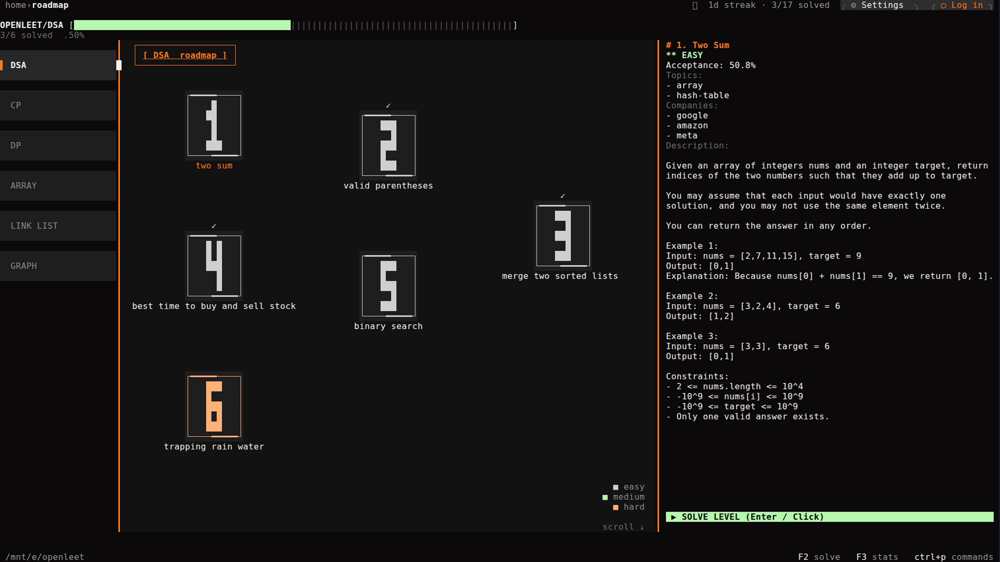
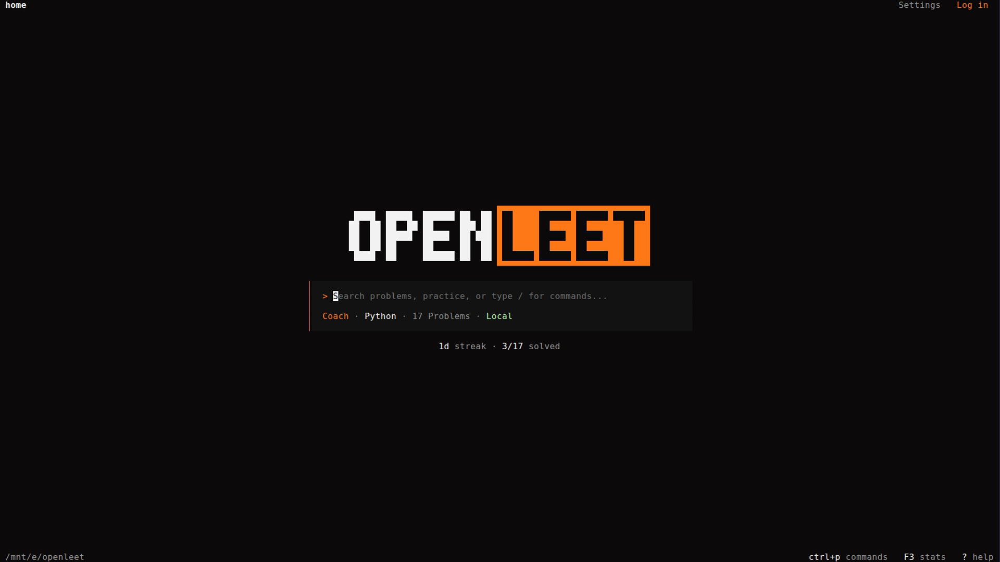
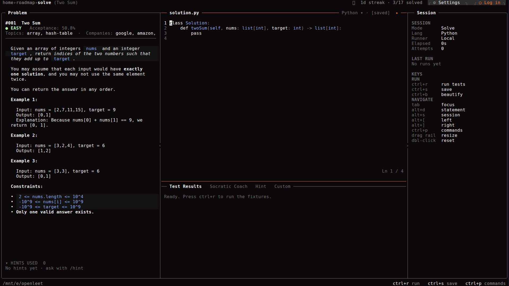
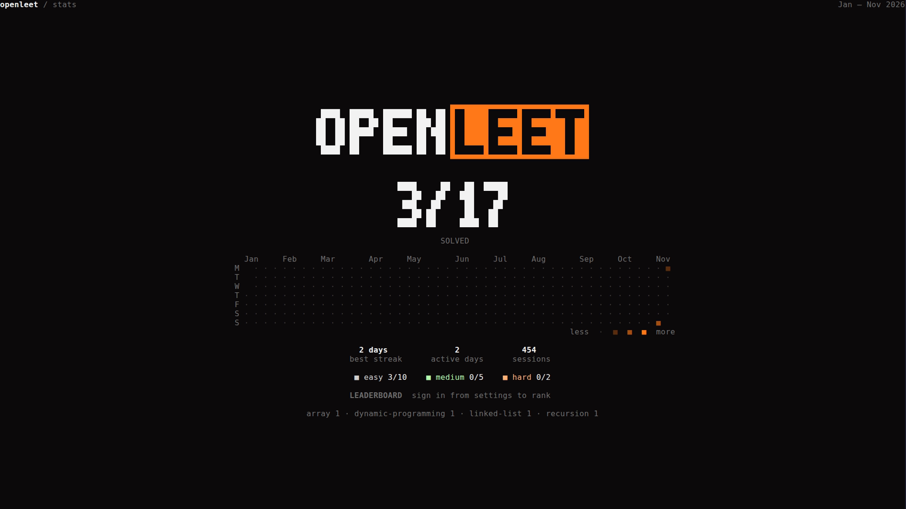
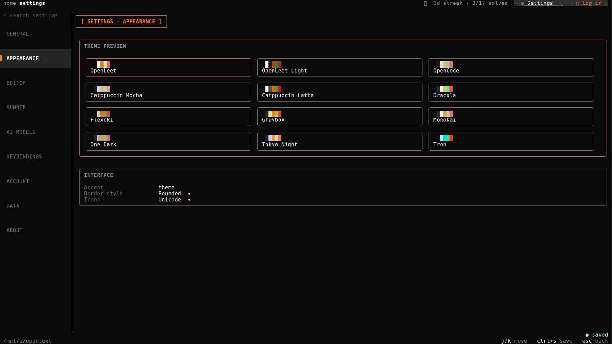
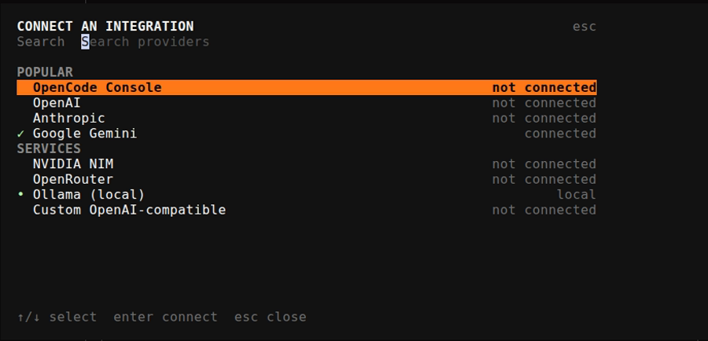
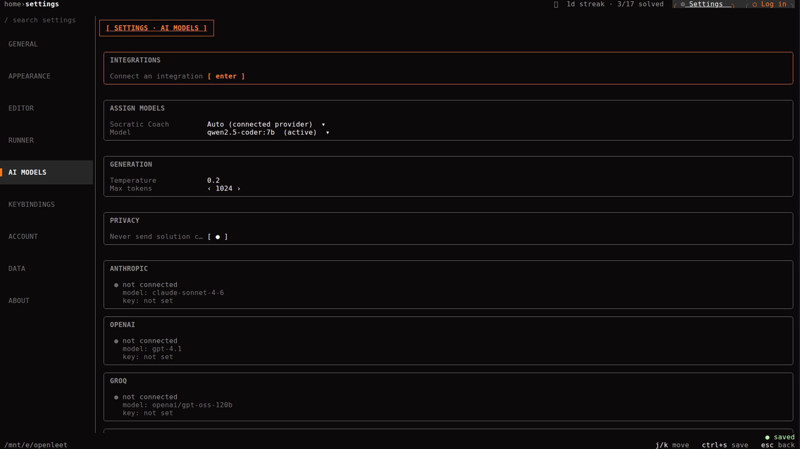
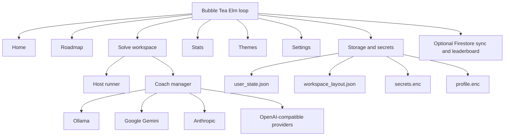

<div align="center">

<h1>OPENLEET</h1>

<p><strong>A terminal-first DSA practice dojo with a Socratic AI coach.</strong></p>

<p>Practice algorithms, run tests against your own toolchain, and get guided hints without leaving the keyboard.</p>

<p>
<a href="readme/FEATURES.md">Features</a> ·
<a href="readme/AI_PROVIDERS.md">AI Providers</a> ·
<a href="readme/ARCHITECTURE.md">Architecture</a> ·
<a href="readme/SCREENSHOTS.md">Screenshots</a>
</p>

<p>


</p>

</div>



## Why OpenLeet

Most interview-prep tools are browser tabs pretending to be a workspace. OpenLeet is the opposite: a fast, keyboard-driven terminal app that keeps the problem, your code, the test runner, and the AI coach in one focused surface.

It is built for the way engineers actually practice:

- **Local by default** — your progress, code buffers, and layout stay on your machine.
- **No browser, no account required** — open the app and solve.
- **A real runner** — execute against your installed Python or Go toolchain.
- **A coach, not an answer machine** — the Socratic prompt asks questions and points at the next useful idea instead of dumping a solution.
- **A UI that respects the terminal grid** — every screen is sized from the current viewport, not a hardcoded 80×24 assumption.

## Feature highlights

| Area | What it does |
| :--- | :--- |
| **Home** | A quiet landing screen with inline problem search, a context-aware quick-action palette, the current language, and one line of progress under the search box. |
| **Roadmap** | A winding, game-like grid of problems with topic/company filters, solved markers, mouse hit-testing, and keyboard navigation. |
| **Solve workspace** | Three-pane workspace: rendered problem statement, code editor, and a console with Test Results, Socratic Coach, Hint, and Custom test tabs. |
| **Host runner** | Detects Python and Go on the host, injects a hidden test harness, runs with a timeout, cleans up the process tree, and maps errors back to editor lines. |
| **AI teacher** | Searchable **Connect an integration** modal, native Gemini and Anthropic streaming, Groq/NVIDIA/OpenRouter/OpenCode through an OpenAI-compatible adapter, local Ollama, and encrypted API-key storage. |
| **Themes** | Twelve dark and light palettes (OpenLeet, OpenLeet Light, Catppuccin Mocha/Latte, and more), live preview before apply, the gallery in Settings → Appearance (`F4`), and `--list-themes` for scripting. |
| **Quick actions** | A context-aware `/` palette that opens centered popups over the current screen. Theme, language, provider, model, stats, and roadmap filters apply without leaving the page; only `/settings` and `/roadmap` navigate. |
| **Settings** | Schema-driven settings with search, nine categories, exact-grid layout, mouse support, and a 100×30 minimum terminal target. |
| **Data tools** | Export progress to JSON/CSV, import JSON, timestamped backups, cache clear, roadmap reset, settings reset, and local-data deletion. |
| **Optional sync** | Firebase Google browser sign-in or email/password, plus per-user Firestore sync; ID tokens remain memory-only and database rules enforce per-user access. |
| **Leaderboard** | A signed-in-only global ranking that stores only display name, score, solved count, and update time. No email, solution code, or per-problem history is uploaded. |
| **Quality** | Unit tests across the UI, runner, coach, storage, secrets, eventbus, and network layers, plus headless VHS captures for visual review. |

## Quick actions

Type `/` on Home or press `Ctrl+P` anywhere to open the context-aware command palette. Slash commands are quick actions, not navigation: the active screen stays behind a dimmed overlay, and applying a command closes back to the same focus, scroll, and editor cursor.

- `/themes`, `/lang`, `/connect`, and `/model` open searchable pickers and write the same settings used by Settings > Appearance and Settings > AI Models.
- `/stats` opens a read-only streak, difficulty, and seven-day summary.
- `/filter` and `/topic` update the roadmap filter without leaving the current screen.
- `/run`, `/save`, `/random`, and `/reset` act immediately; `/reset` asks for confirmation first.
- `/login` (aliases `/google`, `/signin`) starts Google browser sign-in without leaving the current screen.
- `/settings` and `/roadmap` are the only commands that change the page. Typing a full command in the palette executes it directly, so `/settings ai` opens Settings on AI Models.
- On the Roadmap, `/` still opens its inline command bar (`/solve`, `/topic`, `/company`, `/dsa`, `/clear`); `Ctrl+P` opens the global palette from there.

Home exposes `/solve /roadmap /login /random /filter /topic /themes /lang /connect /stats /settings /quit`. Solve exposes `/run /save /coach /hint /reset /roadmap /login /lang /themes /model /connect /settings /quit`.

## What this project demonstrates

- **Production-grade TUI architecture** — a single Elm loop, dynamic geometry, exact-grid rendering, and reusable modal/overlay contracts.
- **Streaming AI integration** — native Gemini and Anthropic SSE clients, an OpenAI-compatible adapter for NVIDIA/OpenRouter/OpenCode, and a local Ollama path.
- **Security-minded local storage** — AES-256-GCM vaults, OS-user-derived keys, masked secrets, and memory-only identity tokens.
- **Systems programming in Go** — subprocess isolation, process-tree termination, runtime detection, harness injection, and traceback remapping.
- **Test discipline** — fake HTTP providers, exact-grid tests, mouse hit-testing tests, and headless VHS visual receipts.
- **Product thinking** — a coherent keyboard-first workflow from roadmap to statement to editor to tests to coaching.

## Screenshots

<table>
<tr>
<td width="50%"><br><sub><b>Home</b> — problem search and quick actions</sub></td>
<td width="50%"><br><sub><b>Solve</b> — statement, editor, and Socratic Coach</sub></td>
</tr>
<tr>
<td width="50%"><br><sub><b>Roadmap</b> — winding grid with filters and solved state</sub></td>
<td width="50%"><br><sub><b>Stats</b> - solved count, streaks, heatmap, difficulty split, leaderboard</sub></td>
</tr>
<tr>
<td width="50%"><br><sub><b>Themes</b> - light and dark palettes with live preview</sub></td>
<td width="50%"><br><sub><b>AI teacher</b> — searchable provider integration picker</sub></td>
</tr>
</table>

## Quick start

### Requirements

- Go toolchain matching [`go.mod`](go.mod)
- Optional: Python 3 and/or Go installed locally for code execution
- Optional: Ollama or a cloud provider API key for the Socratic Coach

### Build and run

**Windows**

```powershell
git clone https://github.com/srikar-up/openleet.git
cd openleet
go build -o .\bin\openleet.exe .\cmd\openleet
.\bin\openleet.exe
```

**Linux / macOS**

```bash
git clone https://github.com/srikar-up/openleet.git
cd openleet
go build -o ./bin/openleet ./cmd/openleet
./bin/openleet
```

**Windows installer**

```powershell
irm https://raw.githubusercontent.com/srikar-up/openleet/main/install.ps1 | iex
```

The installer uses a local build when Go is available, otherwise it downloads the
latest published release archive and verifies its checksum. To pin a version, set
`OPENLEET_VERSION`, for example `v0.5.0-beta`. From a clone, `.\install.ps1` works too.

### Optional Firebase account and leaderboard

```powershell
Copy-Item .env.example .env
```

Then fill in `FIREBASE_PROJECT_ID` and `FIREBASE_API_KEY`. Email/password sign-in works with just those two values.

For Google browser sign-in, open **Google Cloud Console → Google Auth Platform → Clients** (older consoles: **APIs & Services → Credentials**), create an OAuth client of type **Desktop app** in the same Google Cloud project as Firebase, and set:

```env
GOOGLE_OAUTH_CLIENT_ID=your-desktop-app-client-id
GOOGLE_OAUTH_CLIENT_SECRET=your-desktop-app-client-secret
```

Desktop client secrets are not confidential; the flow still uses PKCE and a loopback redirect on `127.0.0.1`. Do **not** use a **Web application** client for this flow; Google rejects its loopback redirect with `redirect_uri_mismatch`. The Google auth domain (`*.firebaseapp.com`) is not an OAuth client ID.

### Useful flags

```bash
./bin/openleet --view roadmap
./bin/openleet --view settings --settings-section ai
./bin/openleet --view roadmap --theme openleet-light
./bin/openleet --list-themes
./bin/openleet --version
```

## Keyboard map

| Key | Action |
| :--- | :--- |
| `F1` | Home → Roadmap |
| `F2` | Open the selected problem in Solve |
| `F3` | Stats dashboard |
| `F4` | Settings → Appearance |
| `F5` / `Ctrl+,` | Settings |
| `F6` | Focus the top bar; `Tab` / `Shift+Tab` cycle the labels, `Enter` activates |
| `Ctrl+P` | Command palette |
| `Ctrl+R` | Run tests |
| `Ctrl+S` | Save buffer |
| `Ctrl+B` | Beautify code |
| `Ctrl+N` | Notifications |
| `?` | Help |
| `Tab` | Cycle focus |
| `Esc` | Back, close overlay, or clear top-bar focus |
| `Ctrl+C` | Quit |

> `Ctrl+,` is supported, but `F5` is the reliable Settings shortcut in terminals that cannot encode `Ctrl+,` consistently.

## AI teacher connection

Open **Settings → AI Models**, then press `c` or click **Connect an integration**.



The picker groups providers into **Popular** and **Services**, supports live search, and opens the API-key/base-URL/model detail for the selected provider.

| Provider | Protocol | Default endpoint |
| :--- | :--- | :--- |
| OpenCode Console | OpenAI-compatible | `https://opencode.ai/inference/v1` |
| OpenAI | OpenAI-compatible | `https://api.openai.com` |
| Groq | OpenAI-compatible | `https://api.groq.com/openai/v1` |
| Anthropic | Native Messages API | `https://api.anthropic.com` |
| Google Gemini | Native Gemini SSE | `https://generativelanguage.googleapis.com` |
| NVIDIA NIM | OpenAI-compatible | `https://integrate.api.nvidia.com/v1` |
| OpenRouter | OpenAI-compatible | `https://openrouter.ai/api` |
| Ollama | Local native | `http://localhost:11434` |
| Custom | OpenAI-compatible | user-supplied |

**Security model**

- Provider API keys live in an encrypted `secrets.enc` vault (AES-256-GCM, mode `0600`), never in `config.json`.
- Keys are masked in every UI surface.
- The coach uses the selected provider; explicit cloud choices do not silently fall back to Ollama.
- Firebase ID tokens are memory-only and are never written to config or sync metadata. The long-lived refresh token is stored encrypted in `session.enc` (AES-256-GCM, mode `0600`) so the next launch can restore the session.
- Google browser sign-in uses OAuth 2.0 with PKCE and a loopback listener bound to `127.0.0.1`; the Firebase refresh token is encrypted on the device, and Google access tokens are never persisted.
- The optional leaderboard publishes only display name, score, solved count, and update time. Email, solution code, and per-problem history never leave the device.

See [AI Providers](readme/AI_PROVIDERS.md) for configuration details and live endpoint examples.

## Architecture



The app uses a single Bubble Tea `Update` loop. Background producers publish through `internal/eventbus`; one pump goroutine is the only bridge back into the UI. Views are rendered as an exact character grid and repadded after truncation so resizes cannot leave stale glyphs.

Read the full design notes in [Architecture](readme/ARCHITECTURE.md).

## Project layout

```text
cmd/
  openleet/          application entry point
  jev-route/         optional task-routing CLI

internal/
  coach/             streaming providers, manager, Socratic prompts
  config/            config paths and persistence
  eventbus/          bounded async event pipeline
  identity/          encrypted local identity and guest claim
  jev/               System One routing client for the optional CLI
  model/             problem, execution, and user-state types
  network/           Firebase auth and Firestore sync client
  runner/            host detection, harness injection, execution, formatting
  secrets/           encrypted provider-key vault
  storage/           problems, user state, workspace layout, encrypted profile
  ui/
    commands/        context-aware slash command catalog
    home/            landing screen, problem search, mini stats
    mapview/         roadmap grid and filters
    quickdialog/     reusable centered list/input/confirm dialog
    settings/        schema-driven settings and AI integration picker
    stats/           activity dashboard
    theme/           palettes, contrast guards, and theme registry
    toast/           notification stack
    uikit/           exact-grid text and paint helpers
    workspace/       split solve workspace and console
```

## Quality

```bash
go vet ./...
go test ./... -count=1
```

The repository also includes headless VHS capture scripts:

```bash
bash scripts/capture-tui.sh roadmap
bash scripts/capture-tui.sh settings openleet ai
```

Captures are checked for border geometry, clipping, whitespace balance, and contrast. The app is designed for a minimum **100×30** terminal and adapts upward without hardcoded dimensions.

## Project status

OpenLeet is under active development.

- **Implemented:** local practice loop, roadmap, solve workspace, Python/Go runner, stats, light and dark themes, schema-driven settings, AI provider picker and streaming, encrypted local stores, data export/import/backup.
- **Optional:** Firebase account and cloud sync. Live two-user validation requires a deployed Firestore project and rules.
- **Not yet implemented:** OAuth/device-code login, account-management endpoints, code-buffer cloud sync, and automatic background sync.

## Documentation

| Document | What it covers |
| :--- | :--- |
| [Features](readme/FEATURES.md) | Detailed feature breakdown and current limitations |
| [AI Providers](readme/AI_PROVIDERS.md) | Provider endpoints, selection, key storage, and live test examples |
| [Architecture](readme/ARCHITECTURE.md) | Elm loop, event pipeline, rendering rules, storage, and sync design |
| [Screenshots](readme/SCREENSHOTS.md) | Full capture gallery with captions |
| [Website pack](readme/website/README.md) | Brand, sitemap, design tokens, screen specs, copy, asset manifest, and launch checklist |
| [Changelog](CHANGELOG.md) | Release history and interface notes |

## Built with

- [Go](https://go.dev/)
- [Bubble Tea](https://github.com/charmbracelet/bubbletea)
- [Lip Gloss](https://github.com/charmbracelet/lipgloss)
- [Bubbles](https://github.com/charmbracelet/bubbles)
- [Glamour](https://github.com/charmbracelet/glamour)
- [VHS](https://github.com/charmbracelet/vhs) for visual receipts

## Support

- [Report a bug](https://github.com/srikar-up/openleet/issues/new?template=bug_report.yml)
- [Request a feature](https://github.com/srikar-up/openleet/issues/new?template=feature_request.yml)
- [Ask something else or flag an out-of-scope idea](https://github.com/srikar-up/openleet/issues/new?template=other.yml)
- [Report a security vulnerability privately](https://github.com/srikar-up/openleet/security/advisories/new)

The issue forms ask for the app version, terminal, and operating system up front,
and include a free-form "Other" path when a report does not fit a template.

## Contributing

Contributions are welcome. Read [CONTRIBUTING.md](CONTRIBUTING.md) before opening
a pull request. In short:

1. Fork the repository and create a focused branch.
2. Keep the Elm loop single-threaded; dispatch side effects through `tea.Cmd`.
3. Add or update tests for behaviour changes.
4. Run `go vet ./...` and `go test ./... -count=1`.
5. Include a screenshot when a layout change is visible.

## Security

Provider keys, local identity, and account sessions are encrypted on disk.
Please report vulnerabilities privately as described in [SECURITY.md](SECURITY.md).
Do not open a public issue for a secret-handling bug.

## License

OpenLeet is released under the [MIT License](LICENSE).
