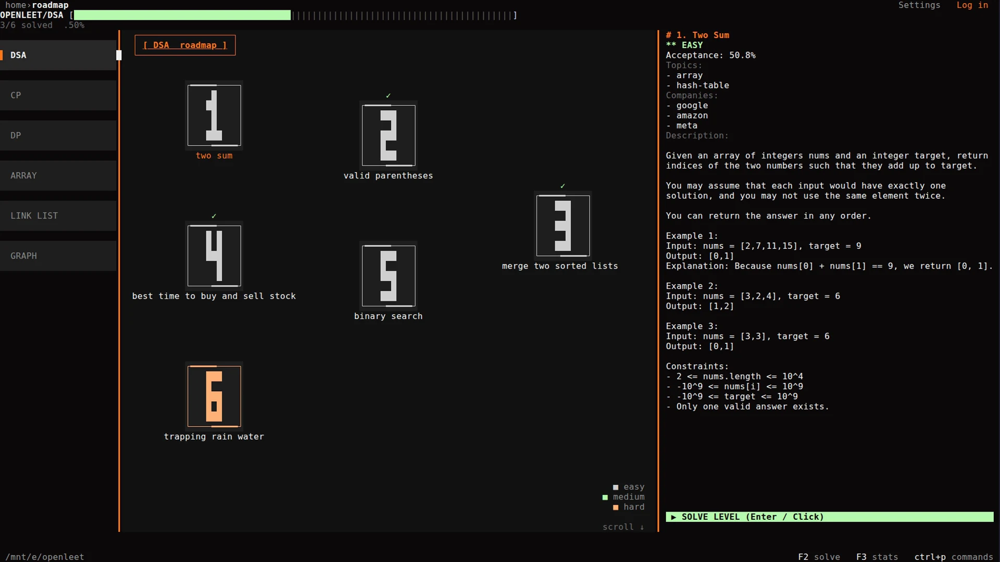
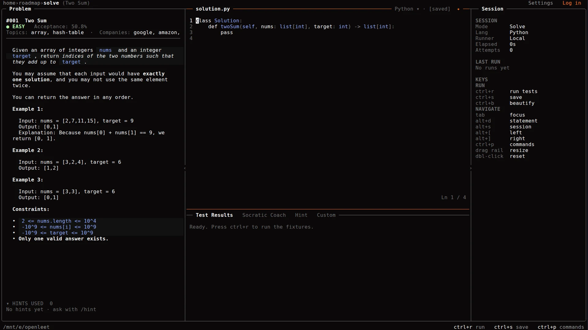

<div align="center">

# OPENLEET

**A terminal-first DSA practice dojo with a Socratic AI coach.**

Local-first · Python + Go · 12 themes · Windows, Linux, macOS

[](https://github.com/srikar-up/openleet/releases/tag/v0.5.0-beta)
[](https://go.dev)
[](LICENSE)

[Download](#download) · [Screenshots](readme/SCREENSHOTS.md) · [Docs](#documentation) · [Report an issue](https://github.com/srikar-up/openleet/issues/new/choose)

</div>



## Download

**Latest beta: [v0.5.0-beta](https://github.com/srikar-up/openleet/releases/tag/v0.5.0-beta)** · [all releases](https://github.com/srikar-up/openleet/releases)

| Platform | Download |
| :--- | :--- |
| Windows x86_64 | [ZIP](https://github.com/srikar-up/openleet/releases/download/v0.5.0-beta/openleet_Windows_x86_64.zip) |
| Windows arm64 | [ZIP](https://github.com/srikar-up/openleet/releases/download/v0.5.0-beta/openleet_Windows_arm64.zip) |
| Linux x86_64 | [tar.gz](https://github.com/srikar-up/openleet/releases/download/v0.5.0-beta/openleet_Linux_x86_64.tar.gz) |
| Linux arm64 | [tar.gz](https://github.com/srikar-up/openleet/releases/download/v0.5.0-beta/openleet_Linux_arm64.tar.gz) |
| macOS x86_64 | [tar.gz](https://github.com/srikar-up/openleet/releases/download/v0.5.0-beta/openleet_Darwin_x86_64.tar.gz) |
| macOS arm64 | [tar.gz](https://github.com/srikar-up/openleet/releases/download/v0.5.0-beta/openleet_Darwin_arm64.tar.gz) |
| Checksums | [SHA-256](https://github.com/srikar-up/openleet/releases/download/v0.5.0-beta/checksums.txt) |

**Windows installer**

```powershell
irm https://raw.githubusercontent.com/srikar-up/openleet/main/install.ps1 | iex
```

**Linux / macOS installer**

```bash
curl -fsSL https://raw.githubusercontent.com/srikar-up/openleet/main/install.sh | bash
# or
wget -qO- https://raw.githubusercontent.com/srikar-up/openleet/main/install.sh | bash
```

The Unix installer detects Linux/macOS and x86_64/arm64, verifies the release
SHA-256, and installs to `~/.local/bin` (`/usr/local/bin` as root). Override the
directory with `OPENLEET_INSTALL_DIR`.

Prefer a direct archive? Extract it and run `openleet` (or `openleet.exe`). The app needs a terminal of at least **100×30**. Python 3 and Go are optional and detected at runtime.

Beta builds are unsigned. Windows amd64 and Linux amd64 are the smoke-tested targets.

Building a download page? Use [`version.json`](version.json) instead of scraping GitHub — it carries the latest tag, direct links, install commands, and SHA-256 checksums. [Feed docs →](readme/VERSION_FEED.md)

## What it does

- **Roadmap** — a winding, filterable problem grid with solved markers and mouse hit-testing.
- **Solve** — statement, editor, session rail, and console on one screen.
- **Runner** — real Python and Go tests on your machine, with timeouts and traceback mapping.
- **Coach** — Socratic hints through Ollama, Gemini, Anthropic, or any OpenAI-compatible provider.
- **Stats** — streaks, a twelve-month heatmap, difficulty split, and topic counts.
- **Themes** — twelve dark and light palettes with a contrast audit.
- **Local-first** — progress, buffers, and keys stay on your machine; accounts and sync are optional.

## Build from source

```bash
git clone https://github.com/srikar-up/openleet.git
cd openleet
go build -o ./bin/openleet ./cmd/openleet
./bin/openleet
```

Go 1.27.3+ is required. Run the checks with:

```bash
go vet ./...
go test ./... -count=1
```

## Screenshots

<div align="center">


</div>

[All screenshots and themes →](readme/SCREENSHOTS.md)

## Documentation

| Doc | Covers |
| :--- | :--- |
| [Features](readme/FEATURES.md) | Full feature list and limitations |
| [AI](readme/AI_PROVIDERS.md) | Provider setup and endpoints |
| [Keys](readme/website/06-KEYBINDINGS.md) | Every shortcut by screen |
| [Architecture](readme/ARCHITECTURE.md) | Elm loop, event pipeline, rendering |
| [Screenshots](readme/SCREENSHOTS.md) | Every screen and theme |
| [Version feed](readme/VERSION_FEED.md) | Machine-readable release JSON for websites |
| [Website](readme/website/README.md) | Brand, copy, assets, launch checklist |
| [Changelog](CHANGELOG.md) | Release history |
| [Contributing](CONTRIBUTING.md) | Build, test, and PR rules |
| [Security](SECURITY.md) | Private vulnerability reporting |

## Support

- [Report a bug](https://github.com/srikar-up/openleet/issues/new?template=bug_report.yml)
- [Request a feature](https://github.com/srikar-up/openleet/issues/new?template=feature_request.yml)
- [Other / out of scope](https://github.com/srikar-up/openleet/issues/new?template=other.yml)
- [Security report](https://github.com/srikar-up/openleet/security/advisories/new)

## License

[MIT](LICENSE) © 2026 srikar-up
