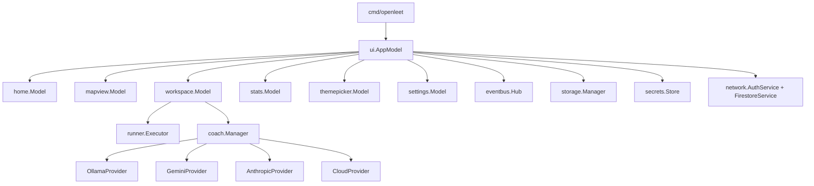

# Architecture

OpenLeet is a single-binary terminal application built with Go, Bubble Tea, Lip Gloss, Bubbles, and Glamour.

The design goal is simple: every state change happens in one Elm loop, every frame is a deterministic character grid, and every background producer is isolated behind a bounded event pipeline.

## High-level flow



## Package map

| Package | Responsibility |
| :--- | :--- |
| `cmd/openleet` | Flag parsing, config loading, Bubble Tea program startup |
| `internal/config` | Config paths, defaults, JSON persistence |
| `internal/model` | Problems, execution results, user state |
| `internal/runner` | Runtime detection, harness generation, execution, formatting |
| `internal/coach` | Streaming providers, Socratic prompts, manager, stream messages |
| `internal/storage` | Problems, user state, workspace layout, encrypted profile |
| `internal/secrets` | Encrypted provider-key vault |
| `internal/network` | Firebase Identity Toolkit and Firestore REST clients |
| `internal/eventbus` | Bounded asynchronous fan-in and frame batching |
| `internal/ui` | Root app model, routing, quick-action handlers, overlays, toasts |
| `internal/ui/commands` | Context-aware slash command catalog and navigation classification |
| `internal/ui/home` | Landing screen and inline problem search |
| `internal/ui/mapview` | Roadmap grid, filters, mouse hit-testing |
| `internal/ui/quickdialog` | Reusable centered list/input/confirm dialog |
| `internal/ui/workspace` | Solve workspace, editor, console |
| `internal/ui/stats` | Activity dashboard and heatmap |
| `internal/ui/theme` | Palette contracts and registry |
| `internal/ui/themepicker` | Full-screen theme gallery |
| `internal/ui/settings` | Schema-driven settings and integration picker |
| `internal/ui/uikit` | Exact-grid text and background helpers |

## Elm architecture

Every UI component follows the Bubble Tea contract:

```go
type Model struct { ... }

func (m Model) Init() tea.Cmd
func (m Model) Update(msg tea.Msg) (tea.Model, tea.Cmd)
func (m Model) View() string
```

Rules enforced in the codebase:

- No blocking I/O in `Update`.
- All asynchronous work is returned as a `tea.Cmd`.
- Child updates reassign their models:
  ```go
  m.list, cmd = m.list.Update(msg)
  ```
- Root width and height are the source of truth.
- Child sizes are derived during render, not cached as deltas.
- Background goroutines never mutate a model or build a view string.

## Event pipeline

`internal/eventbus` is the bridge between producers and the Elm loop.

```text
provider tokens ─┐
geometry probes ─┼─► Hub.Publish (non-blocking, bounded)
logs ────────────┤
activity ────────┘
                      │
                      ▼
                one Pump goroutine
                      │
                      ▼
                 Program.Send
                      │
                      ▼
              AppModel.Update
```

Behavior:

- `Publish` is non-blocking and never mutates a model.
- Exactly one pump goroutine calls `Program.Send`.
- `KindResize` bypasses frame batching and is delivered immediately.
- `KindToken` and `KindLog` coalesce into one `BatchMsg` per 33 ms frame window (30 FPS).
- Lifecycle events are never evicted by token pressure.
- On overflow, tokens and logs drop first; drops are counted per subscription.
- Provider streams are owned by `coach.Manager`, which closes channels and queues terminal errors before closure.

## Rendering model

The terminal is treated as a deterministic character grid.

### Exact frame fill

- The root `AppModel.View` truncates and then pads every frame to the terminal's exact width and height.
- Repadding happens after truncation because cutting in front of a double-width grapheme can leave a cell unused.
- A short frame leaves stale glyphs after a resize, which reads as "the TUI did not re-render".

### Cell-aware text

Views never use byte slicing, `len()` for printable content, or `fmt.Sprintf("%-*s")`.

Instead they use:

- `uikit.Truncate`
- `uikit.Fit`
- `uikit.FitExact`
- `lipgloss.Width`
- `ansi.StringWidth`

This keeps CJK, emoji, and ANSI-styled text aligned.

### Layout composition

- `lipgloss.JoinHorizontal` and `lipgloss.JoinVertical` replace manual newline concatenation.
- Borders, padding, and rails are accounted for explicitly.
- Settings is split into a 22-column sidebar and a canvas; under 100 columns it becomes a short-label tab row.
- Every full-screen view paints its own background through `uikit.PaintBackground`.

### Theme contract

- All colors come from `internal/ui/theme.Palette`.
- Views expose `SetPalette` / `SetTheme`.
- New palettes are registered in `internal/ui/theme/themes.go`.
- `Palette.Light` marks deliberate light-paper themes. Consumers use it to select light-safe rendering, most importantly Glamour’s Markdown style config.
- Every full-screen view paints its own background through `uikit.PaintBackground`, including the landing page and the solve chrome.
- Literal hex colors in views are a review defect.

## Quick actions and overlays

Slash commands are quick actions, not page navigation. `internal/ui/commands` owns the context-aware catalog:

- `ContextHome`, `ContextSolve`, `ContextRoadmap`, `ContextStats`, `ContextThemes`, and `ContextSettings`.
- Every command carries an `Action`; `Navigates` is true only for `/settings` and `/roadmap`.
- The Roadmap keeps its own inline `/` command bar; `Ctrl+P` is the global palette there.
- Home keeps inline problem search only. Slash commands and `Ctrl+P` route to the root command palette.

The root app owns one transient `quickState`:

```text
command palette ──► quickdialog list ──► handler
quick dialog   ──► quickdialog list/input/confirm ──► same-screen apply
toast          ──► one-line footer overlay with TTL
```

- `internal/ui/quickdialog` renders the reusable centered panel: title + `esc`, search, grouped rows, check marks, right-aligned values, and accent selection.
- `overlayPanel` strips the active screen to a dimmed backdrop and splices the panel over its center. The screen underneath keeps its model state, focus, scroll, and editor cursor.
- Handlers never call `switchToSolveView` or change `currentView`; only the `/settings` handler does.
- A handler-coverage test walks every command in every context and fails if any action lacks a `quickHandlers` entry.
- `/themes`, `/lang`, `/connect`, and `/model` write the same `config.Settings` and encrypted vault as Settings. Opening Settings re-syncs its theme selection from the active palette.

The toast is painted over the footer row and expires after four seconds. `tea.Tick` clears only the matching sequence, so a newer toast cannot be removed by an older timer.

## Settings architecture

Settings is schema-driven.

```text
schema.Fields()
   │
   ├─ section
   ├─ card
   ├─ label / help
   ├─ kind (toggle, select, stepper, text, secret, button, ...)
   ├─ default
   └─ validation
```

Benefits:

- Defaults migrate automatically through `EnsureDefaults`.
- Search works across labels, help text, cards, sections, and IDs.
- Settings save to `config.json` as a versioned string map.
- New fields do not require a new hand-written form.

The AI integration picker is a modal layered above the Settings canvas. It uses the same exact-grid overlay helpers as the auth and confirmation dialogs.

## Runner architecture

```text
user buffer
    │
    ▼
harness.Generate(language, problem, code)
    │
    ▼
temporary directory + source file
    │
    ▼
exec.CommandContext with timeout
    │
    ├─ stdout / stderr capture
    ├─ process-tree termination
    ├─ Python traceback remapping
    └─ result parsing
```

- The runner does not bundle language runtimes.
- Python discovery checks `python3` / `python` (and `py` on Windows).
- Go is discovered through `go`.
- Temporary directories are removed after execution.
- Formatting is language-specific:
  - Go: in-process `go/format`
  - Python: `ruff` or `black`, with a conservative fallback

## Coach architecture

`coach.Manager` owns provider selection, stream lifecycle, cancellation, and channel closure.

```text
CoachRequest
    │
    ▼
Manager.selectProvider
    ├─ local Ollama
    └─ cloud provider
           ├─ OpenAI-compatible CloudProvider
           ├─ GeminiProvider
           └─ AnthropicProvider
    │
    ▼
StreamChannels { Tokens, Errors, Done }
    │
    ▼
eventbus pump or direct tea.Cmd
    │
    ▼
ConsoleModel
```

Provider selection is rebuilt from:

- `ai.coach` selection
- `secrets.enc`
- per-provider base URL and model overrides
- `OPENCODE_API_KEY` / `pass.env` fallback in auto mode

`Manager.SetProviders` swaps providers under a mutex. A stream that already selected a provider keeps using its snapshot, so a settings change cannot corrupt an in-flight stream.

## Storage architecture

| File | Format | Purpose |
| :--- | :--- | :--- |
| `config.json` | JSON | User preferences and schema settings |
| `user_state.json` | JSON | Solved problems, scores, attempts, code buffers |
| `workspace_layout.json` | JSON | Pane/workspace layout |
| `secrets.enc` | AES-256-GCM | Provider API keys |
| `profile.enc` | AES-256-GCM | Solved-set summary for optional sync |
| `sync-meta.json` | JSON, mode 0600 | Last successful sync UID/timestamp/note |

Encryption keys are derived from the current OS user and host. No encryption key is compiled into the binary.

## Optional sync architecture

```text
UserState
   │
   ▼
profileFromState
   │
   ├─ encrypted profile.enc
   ├─ Firestore users/{uid}
   └─ Firestore leaderboard/{uid}
          name, score, solved, updated
          ▲
          │ ID token (memory only)
          │
     AuthService
```

- Auth: Firebase Identity Toolkit email/password, or Google via OAuth 2.0 with PKCE (S256) and a loopback listener on `127.0.0.1`. The Google ID token is exchanged through Firebase `accounts:signInWithIdp`.
- Google and Firebase tokens are memory-only; no OAuth token or refresh token is persisted.
- Sync: direct Firestore REST calls with the user's ID token.
- No service account or Admin SDK is used.
- `firestore.rules` restricts `users/{uid}` to the matching authenticated UID.
- `leaderboard/{uid}` is readable by any signed-in user and writable only by the matching UID.
- The leaderboard document is deliberately minimal: display name, score, solved count, and update time. It never contains email, code, or a solved map.
- Leaderboard scores are client-reported. Rules enforce document shape and UID ownership, not gameplay; a server-side verifier would be required for competitive anti-cheat.
- Full offline data, including code, stays local; any future cross-device backup should target the user's own Google Drive, not the app's Firestore project.
- Conflict policies:
  - Newest wins: pull, merge remote-only solved IDs, preserve local code/attempt details, push merged summary.
  - Local wins: skip the pull, push local solved set.
- Failed pushes never update last-synced metadata.
- Expired tokens clear the session.

## Quality architecture

- Unit tests per package.
- Fake HTTP servers for auth, Firestore, Gemini, and Anthropic streaming.
- Exact-grid tests at 100×30 and larger viewports.
- Mouse hit-testing tests share geometry helpers with the renderer.
- VHS captures for visual review.
- `go vet ./...`
- `go test ./...`

## Design invariants

1. No hardcoded terminal dimensions.
2. No blocking work in `Update`.
3. No raw terminal writes in `View`.
4. No literal palette colors in views.
5. No background goroutine touches a model.
6. No event-bus batch mutates models outside `Update`.
7. No frame is allowed to be shorter or narrower than the terminal.
8. No provider key is written to `config.json`.
9. No ID token is persisted.
10. No email, solution code, or solved map in leaderboard documents.
11. Google OAuth uses PKCE and binds the loopback listener to `127.0.0.1`.
12. Every layout change gets a visual receipt.
