# Screenshots

OpenLeet's interface is captured headlessly with VHS so layout changes can be reviewed without a live terminal session.

Most captures use `COLORTERM=truecolor` and a 1920×1080 tape at 16px font size. Narrower captures use 1200×720 or 100×30 logical cells.

## Home

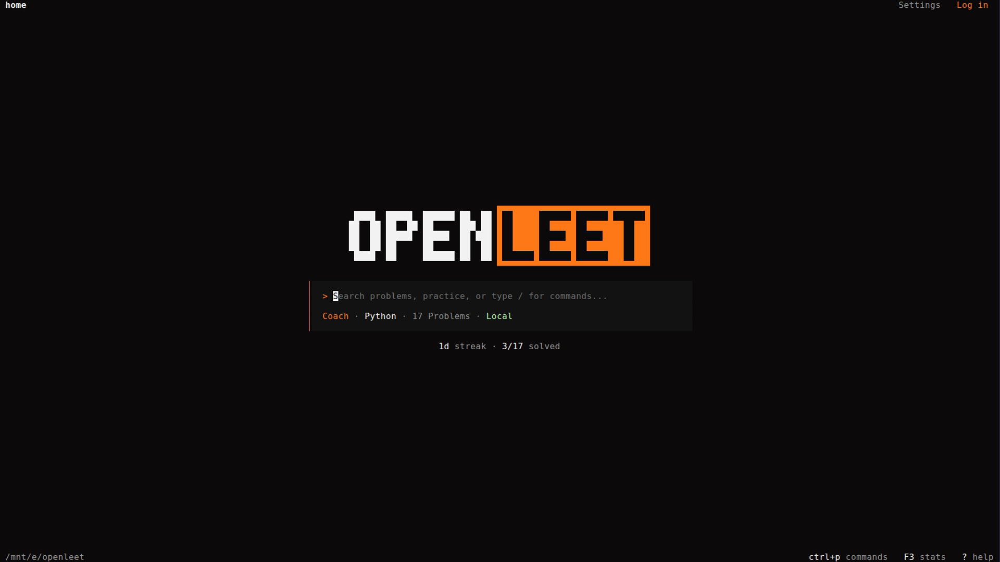

A quiet landing screen with inline problem search, the current language, the
total problem count, and one line of progress under the search box. The header
is a single row: the breadcrumb on the left and plain `Settings` and account
labels on the right, with no icons or brackets.

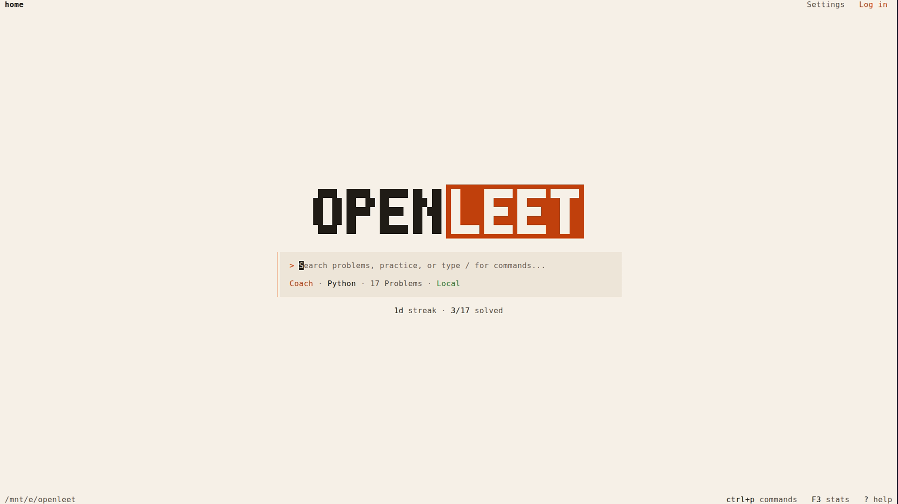

OpenLeet Light uses warm paper, dark ink, and the brand-orange accent. The mini
stats line stays readable in both modes.

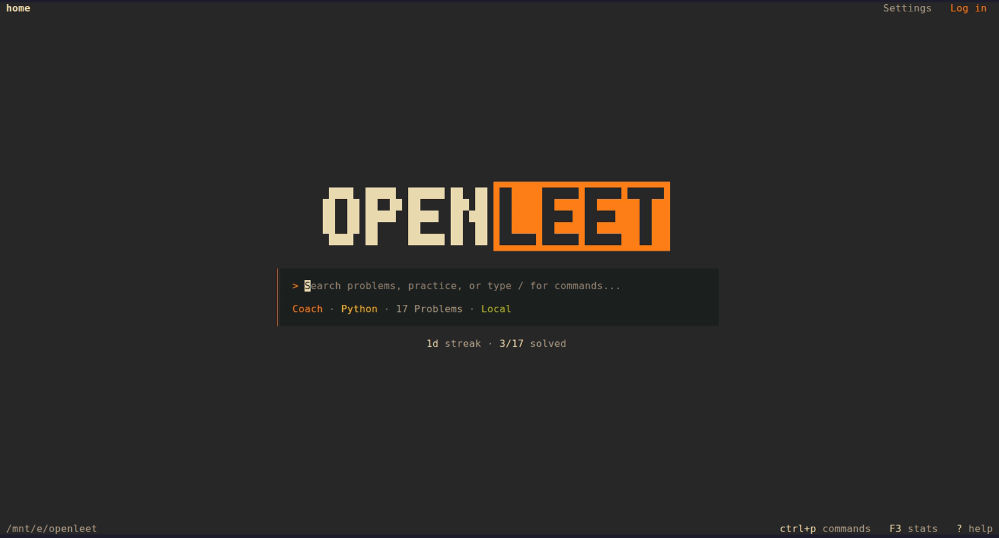
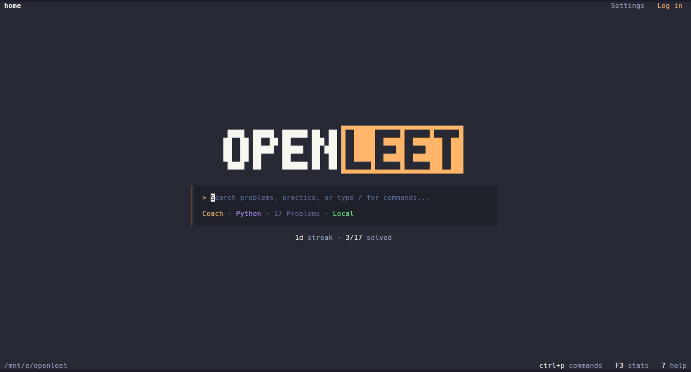
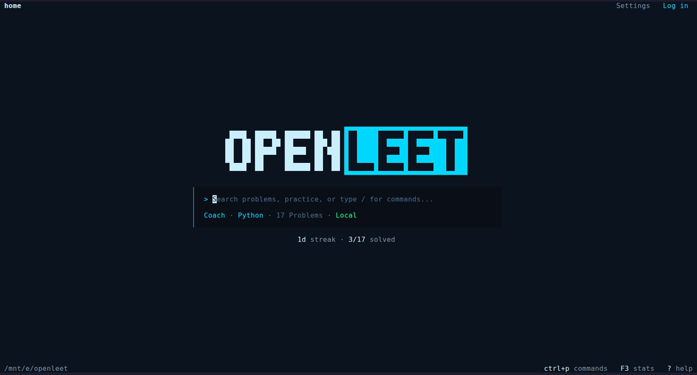

The same header and stats line in Gruvbox, Dracula, and Tron.

## Header focus state

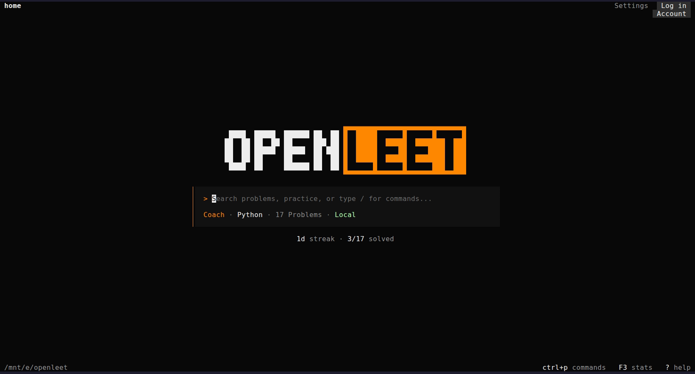

`F6` focuses the chrome, `Tab` cycles the breadcrumb, Settings, and account
labels, and `Enter` activates the focused item. Hover and focus show tooltips
(`Settings (F4)`, `Account`) as a one-row overlay under the label; the header
itself never grows a second row. Captured with `scripts/capture-focus.sh`.

## Quick actions

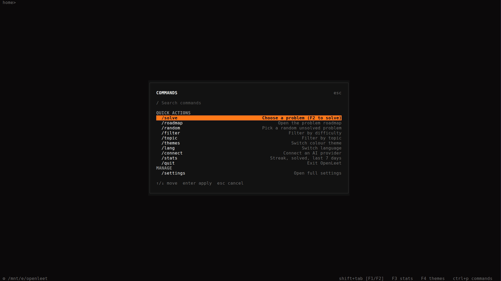

The `/` and `Ctrl+P` palette is context-aware. It opens centered over the current screen with a dimmed backdrop; items apply in place instead of navigating. `/settings` and `/roadmap` are the only commands that change the page.

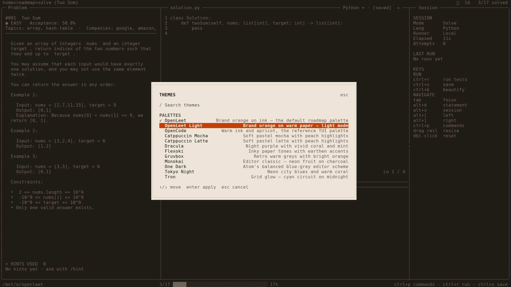

The theme picker live-previews on cursor movement, applies on Enter, and reverts on Esc. The code buffer, cursor, and test results underneath are untouched. Theme, language, provider, and model choices write the same settings used by the full Settings page.

## Roadmap

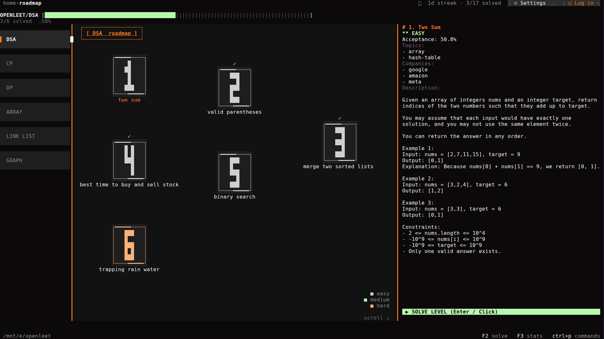

A winding problem grid with difficulty badges, solved markers, section filters, and mouse hit-testing.

## Solve workspace

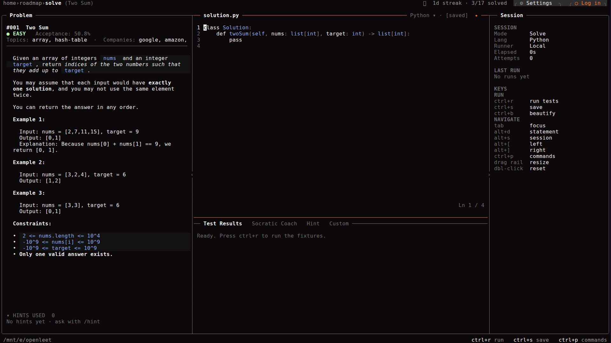

The three-pane workspace: rendered statement, code editor, and a console with Test Results, Socratic Coach, Hint, and Custom tabs.

## Stats

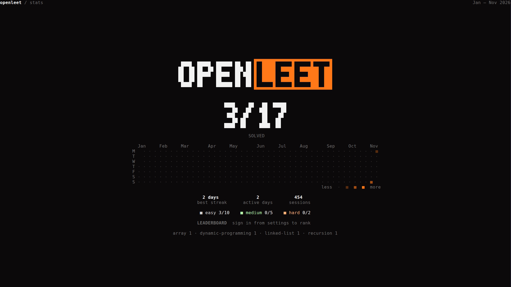

Solved counter, activity heatmap, best streak, active days, difficulty breakdown, and the compact signed-in leaderboard line.

## Themes

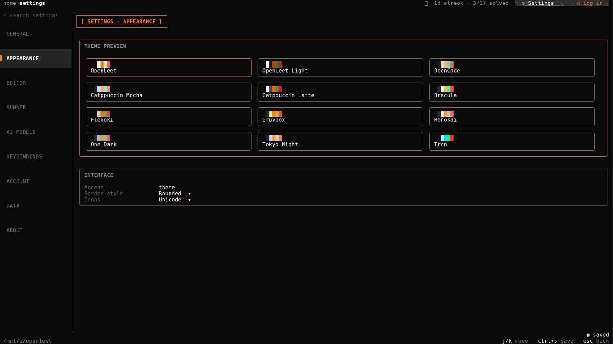

The theme gallery lives in Settings → Appearance. Moving the cursor previews a
palette live; Enter applies, Esc reverts. Light mode ships as `OpenLeet Light`
and `Catppuccin Latte`.

## Light mode


OpenLeet Light uses warm paper, dark ink, and the brand-orange accent. The landing page paints its own canvas, so the light palette stays readable even when the host terminal is dark.

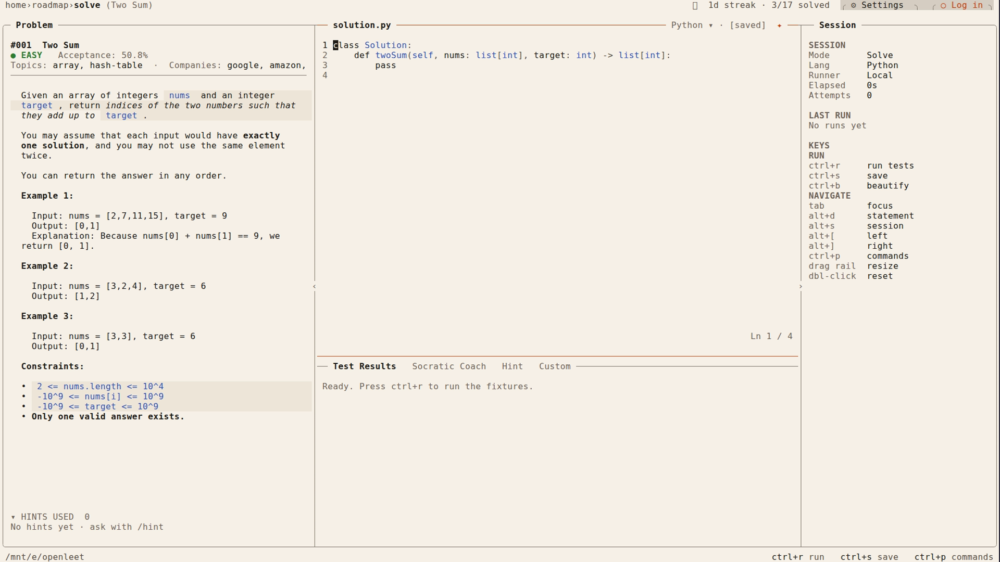

The solve workspace derives the problem statement, inline code, code blocks, editor syntax colors, and chrome from the active palette. Glamour switches to its light style config for light themes.

## AI Models

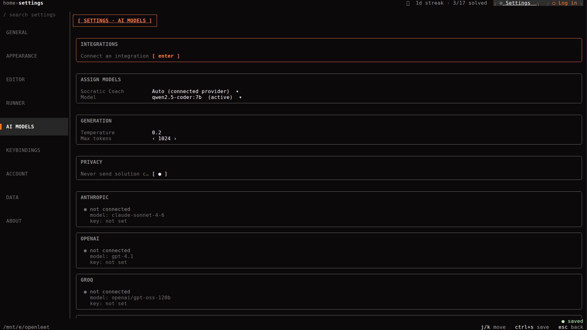

Provider cards for Anthropic, OpenAI, Groq, Google Gemini, NVIDIA NIM, OpenCode Console, OpenRouter, Ollama, and custom OpenAI-compatible endpoints.

## Connect an integration

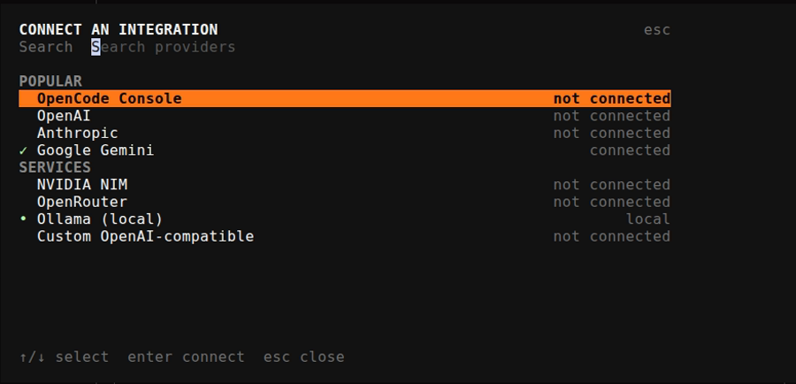

Searchable provider picker with Popular and Services groups, connection status, keyboard navigation, and an accent-highlighted selection.

## Account and optional sync

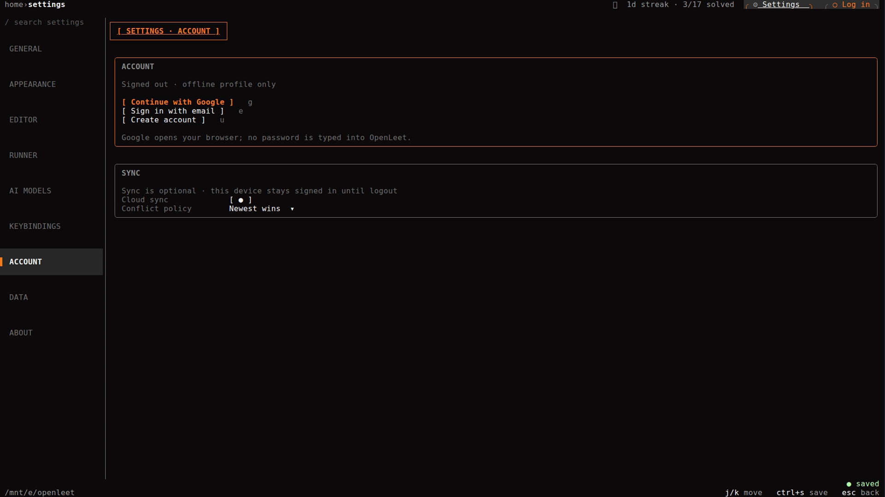

Signed-out account view with Continue with Google, email sign-in, account creation, cloud-sync toggle, and conflict policy.

## Capture commands

```bash
# Home (dark and light)
bash scripts/capture-tui.sh home openleet
bash scripts/capture-tui.sh home openleet-light

# Roadmap
bash scripts/capture-tui.sh roadmap

# Stats
bash scripts/capture-tui.sh stats

# Themes (Settings → Appearance)
bash scripts/capture-tui.sh settings openleet appearance
bash scripts/capture-tui.sh settings dracula appearance

# Light solve workspace
bash scripts/capture-tui.sh solve openleet-light

# Settings → AI Models
bash scripts/capture-tui.sh settings openleet ai

# Narrow viewports: ~100 and ~120 columns at 16px font
VHS_WIDTH=1050 VHS_HEIGHT=650 bash scripts/capture-tui.sh home openleet
VHS_WIDTH=1250 VHS_HEIGHT=700 bash scripts/capture-tui.sh home openleet
```

The capture helper stages the Linux binary on the WSL filesystem before running VHS. This avoids a known 9p mount issue when executing large Go binaries directly from a Windows drive mount.
