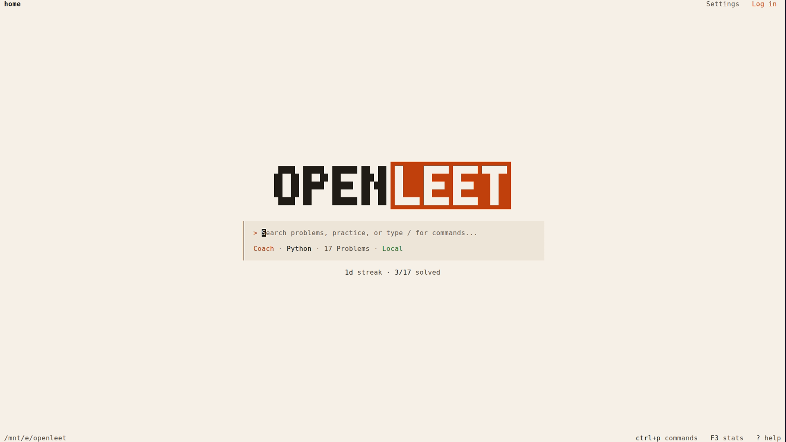
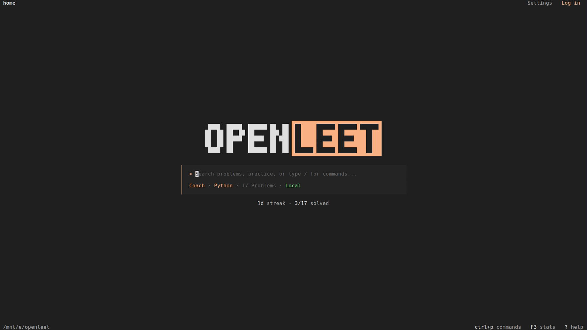
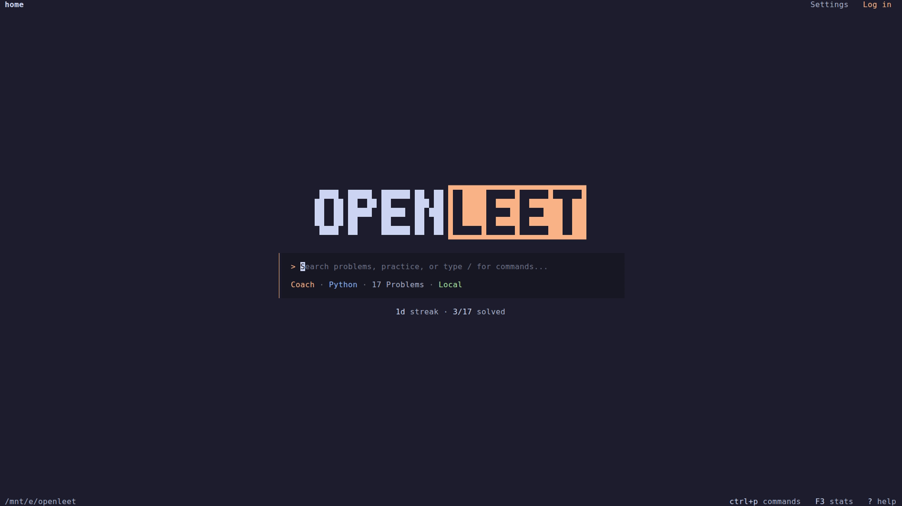
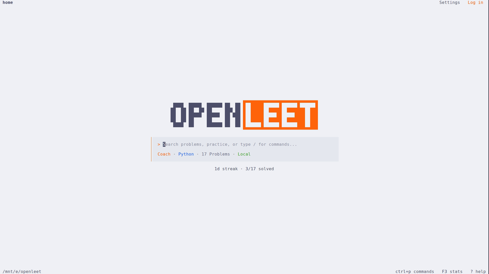
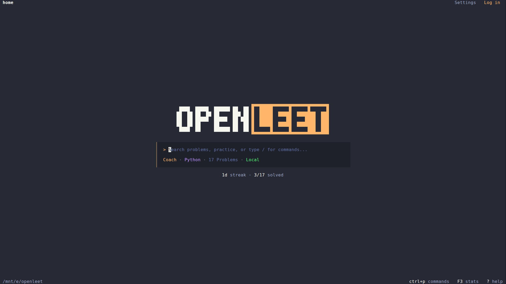
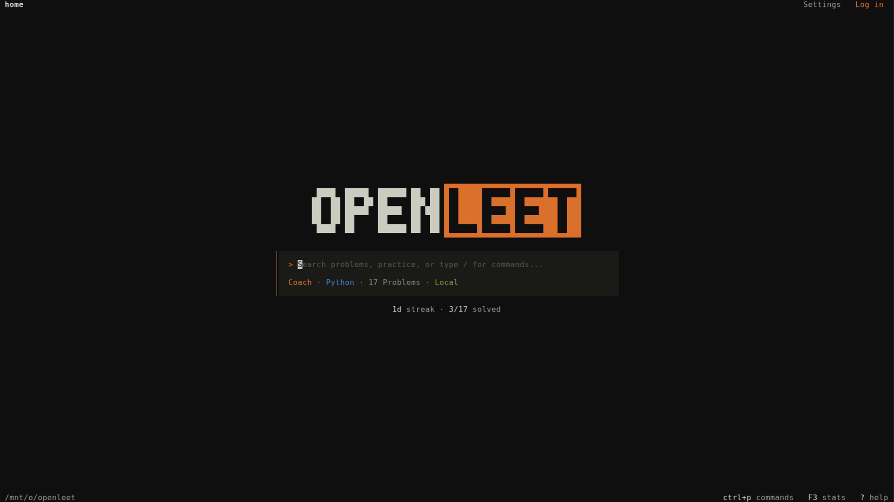
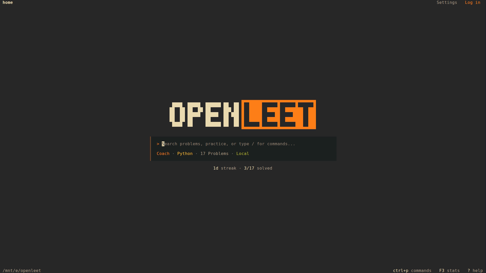
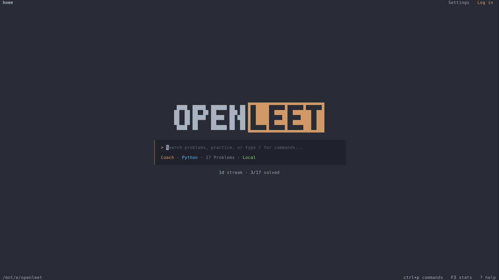

# OpenLeet theme gallery

The Home screen in every built-in palette. All captures use the same terminal
geometry and are **1920×1080**, so only the palette changes between them.

| Theme | Preview |
| :--- | :--- |
| **OpenLeet** |  |
| **OpenLeet Light** |  |
| **OpenCode** |  |
| **Catppuccin Mocha** |  |
| **Catppuccin Latte** |  |
| **Dracula** |  |
| **Flexoki** |  |
| **Gruvbox** |  |
| **Monokai** |  |
| **One Dark** |  |
| **Tokyo Night** |  |
| **Tron** |  |

## Files

```text
openleet.png
openleet-light.png
opencode.png
catppuccin-mocha.png
catppuccin-latte.png
dracula.png
flexoki.png
gruvbox.png
monokai.png
onedark.png
tokyonight.png
tron.png
```

The five canonical Home screenshots one level up (`home.png`,
`home-light.png`, `home-gruvbox.png`, `home-dracula.png`, and `home-tron.png`)
are the same 1920×1080 captures.
