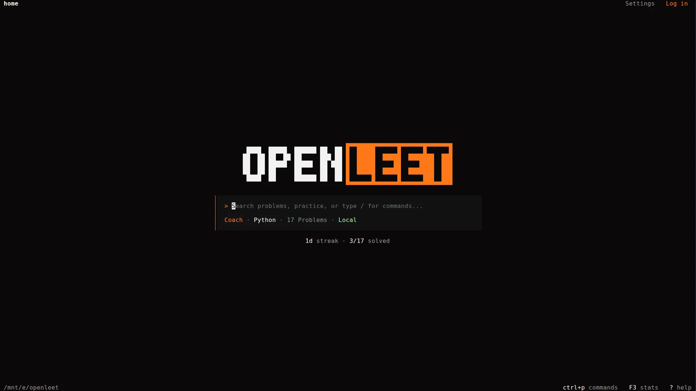
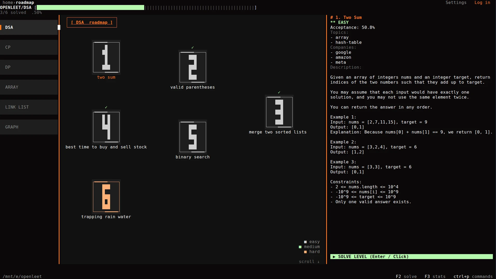
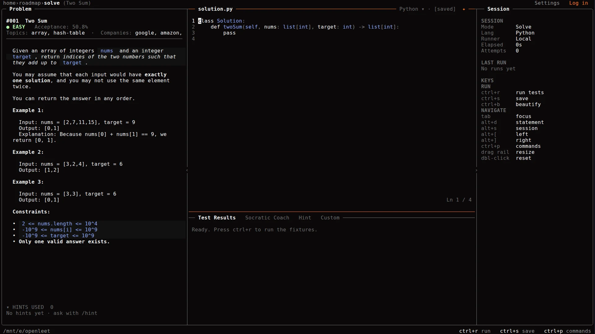
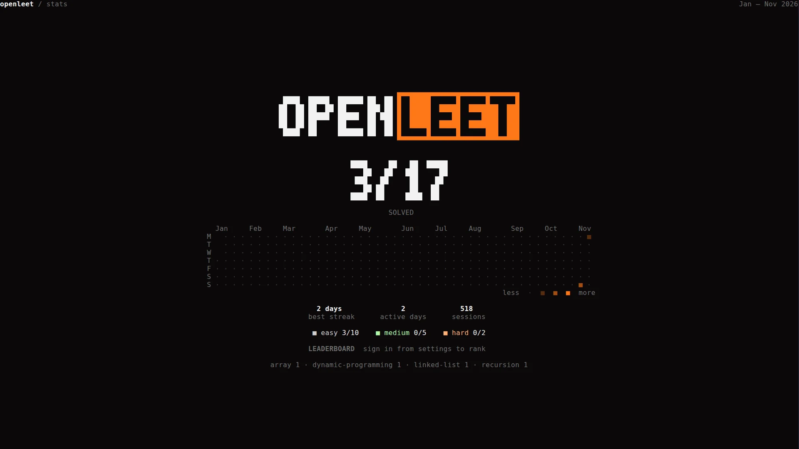
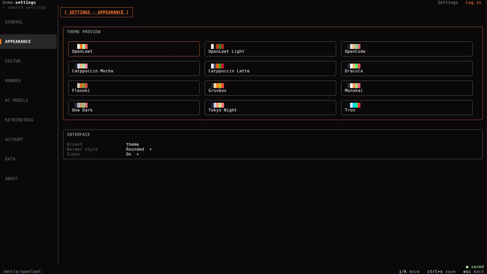
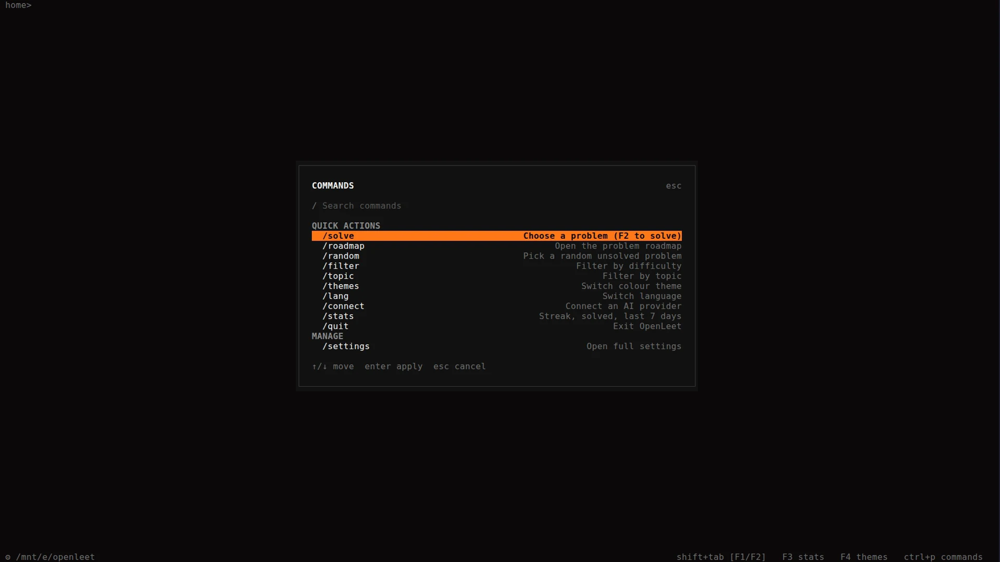
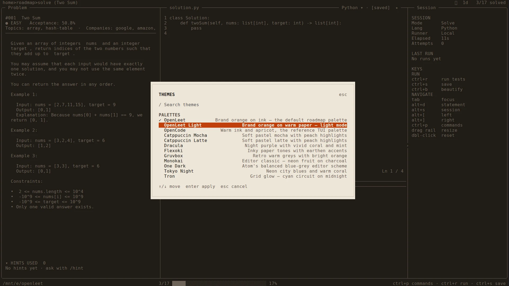

# 05 — Screens

Every screen is captured at 1920×1080 with truecolor unless noted. Images live
in [`../screenshots`](../screenshots); the manifest with alt text is in
[09-ASSETS.md](09-ASSETS.md).

## Shared chrome

Home, Roadmap, Solve, and Settings share one app-level header and footer. Only the
breadcrumb text changes.

```text
┌────────────────────────────────────────────────────────────────────────────┐
│ home›roadmap                                     Settings   email@example.com │  row 0 (one row)
├────────────────────────────────────────────────────────────────────────────┤
│ page body                                                                  │
│                                                                            │
├────────────────────────────────────────────────────────────────────────────┤
│ ~/code/openleet                            F2 solve   F3 stats   ctrl+p commands │ last row
└────────────────────────────────────────────────────────────────────────────┘
```

- **Breadcrumb:** left, once. Ancestors in `text_dim`, current segment bold in
  `text`, separator `›` in `text_dim`. It truncates with `…` before any
  right-side item is clipped. Home shows only `home`.
- **Right side:** two plain labels, `Settings` and the account, right-aligned
  with exactly three visual cells between them. No icons, brackets, slashes, or
  border fragments.
- **Rest state:** labels in `text_dim`; signed-out `Log in` in `accent`.
  Hover/focus: `text` on a borderless `surface_raised` pill with one cell of
  padding each side. Pressed: `accent` text.
- **Account label:** full email at ≥120 columns, the local part before `@` at
  100–119, the first letter below 100, and `Log in` when signed out. It
  truncates with `…` before the edge; one cell of padding remains to the window
  edge.
- **Tooltips:** `Settings (F4)` and `Account` appear only on hover or keyboard
  focus, as a transient one-row pill on the first body row. The header never
  grows a second line.
- **Header background:** the same `background` token as the page body; no
  mismatched band.
- **Footer:** cwd in `text_dim` on the left; exactly three per-screen hints on
  the right, key in `text`, label in `text_dim`, three cells between hints. No
  Settings entry.

## Home



**Purpose:** a quiet landing screen that gets you into the loop in one keystroke.

```text
┌──────────────────────────────────────────────────────────────┐
│ home                                         Settings   Log in │
│                                                              │
│                     OPEN ██████  (pixel wordmark)            │
│                                                              │
│        ┌──────────────────────────────────────────────┐      │
│        │ > Search problems, practice, or type / …     │      │
│        │ Coach · Python · 17 Problems · Local          │      │
│        └──────────────────────────────────────────────┘      │
│                                                              │
│                 1d streak · 3/17 solved                      │
│                                                              │
│ cwd                                      ctrl+p commands  F3 stats  ? help │
└──────────────────────────────────────────────────────────────┘
```

**Zones**

1. **Top bar** — shared chrome: `home` on the left, `Settings` and the account
   label on the right.
2. **Wordmark** — the two-block `OPEN` / `LEET` logo in the display pixel style.
3. **Search card** — one input line with a `>` prompt, then a context line:
   coach status, language, total problem count, and runner mode.
4. **Mini stats** — one blank row under the box, centered on the card width:
   `1d streak · 3/17 solved`. Numbers use `text`; labels and the `·` separator
   use `text_dim`. No icon. Hidden when the streak is 0 and nothing is solved;
   shows only `3/17 solved` when the streak is 0; shortens to `1d · 3/17` if the
   card is too narrow.
5. **Footer** — cwd and three hints.

**Interactions**

- Type to search; `Enter` opens the selected problem.
- `↑/↓` moves through results; `Esc` closes the dropdown.
- `/` or `Ctrl+P` opens the quick-action palette.
- `F2` opens the roadmap (or returns to Solve when a problem is active).
- `F3` opens Stats; `F4` opens Settings → Appearance; `?`/`F1` opens help.
- Clicking the wordmark or top-left breadcrumb returns Home.

**States:** empty search, no results, guest/signed-in label, status toast.

**Screenshots:** `home.webp` (OpenLeet), `home-light.webp`, `home-gruvbox.webp`,
`home-dracula.webp`, `home-tron.webp`.

## Roadmap



**Purpose:** browse the problem set as a winding path, filter it, and launch a
problem.

```text
┌─────────────────────────────────────────────────────────────────────────────┐
│ home›roadmap                                              Settings   Log in │
│                                                                             │
│  DSA       ┌ OPENLEET/DSA [██████████░░░░░░░░] 3/17 solved  .50% ┐          │
│  CP        │                                                     │          │
│  DP        │   [1] two sum        [2] valid parens      [3] merge │  Problem │
│  ARRAY     │        ✓                    ✓                       │  inspector│
│  LINK LIST │   [4] stock          [5] binary search     [6] rain  │  # 1      │
│  GRAPH     │                                                     │  EASY     │
│            │   ... six-card page window, scroll-to-selection ...  │  ...      │
│            └─────────────────────────────────────────────────────┘          │
│                                                                             │
│ ~/code/openleet                          F2 solve  F3 stats  ctrl+p commands │
└─────────────────────────────────────────────────────────────────────────────┘
```

**Zones**

1. **Topic rail** — `DSA`, `CP`, `DP`, `ARRAY`, `LINK LIST`, `GRAPH`; the active
   filter is accent-framed.
2. **Canvas** — a six-card page window over the winding grid. Cards show the
   number, title, difficulty badge, and a solved tick. The window follows the
   selection so mouse targets cannot drift from what is painted.
3. **Inspector** — the selected problem: number, title, difficulty, acceptance,
   topics, companies, and a `SOLVE LEVEL (Enter / Click)` action.
4. **Command bar** — `/` opens the inline roadmap command bar (`/solve`,
   `/topic`, `/company`, `/dsa`, `/clear`).

**Interactions**

- `j/k` or `↑/↓` move; `h/l` or `←/→` change columns; `Enter` opens the problem.
- Click a topic to filter; click a card to select; double-click or `Enter` to solve.
- `F2` opens the selected problem; `Shift+Tab` returns to Home; `F3` Stats.
- `/filter` and `/topic` quick actions apply filters in place.

**Screenshot:** `roadmap.webp` (dark), `roadmap-dracula.webp`.

## Solve workspace



**Purpose:** the practice loop in one surface: read, write, run, ask.

```text
┌──────────────────────────────────────────────────────────────────────────────┐
│ home›roadmap›solve (Two Sum)                              Settings   Log in │
│                                                                              │
│ Problem                    solution.py                 Session               │
│ #001 Two Sum              1 class Solution:            Mode   Solve           │
│ ● EASY  Acceptance 50.8%  2   def twoSum(...):         Lang   Python          │
│ Topics · array · hash     3     pass                   Runner Local           │
│ ─────────────────────     ─────────────────────        Elapsed 0s            │
│ statement, examples,      syntax-highlighted buffer    Attempts 0            │
│ constraints               line numbers, saved dot       Last run             │
│                           Ln 1 / 4                      Keys table           │
│                           ─────────────────────        ─────────────────     │
│                           Test Results · Socratic Coach · Hint · Custom      │
│                           Ready. Press ctrl+r to run the fixtures.           │
│ ~/code/openleet                          ctrl+r run  ctrl+s save  ctrl+p commands │
└──────────────────────────────────────────────────────────────────────────────┘
```

**Zones**

1. **Problem pane** — rendered Markdown: title, difficulty, acceptance, topics,
   companies, examples, constraints. Scrollable; inline code and code blocks
   use palette colours.
2. **Editor pane** — syntax-highlighted buffer, line numbers, language picker,
   save state, beautify icon, cursor line. `[saved]` / dirty dot.
3. **Console** — tabs: `Test Results`, `Socratic Coach`, `Hint`, `Custom`.
   Test results map stdout/stderr back to editor lines. Custom cases take input
   and expected output.
4. **Session rail** — mode, language, runner, elapsed, attempts, last run, and
   the keys table. Collapsible with `alt+s`; drag the rail to resize, double-click
   to reset.
5. **Hints footer** — `HINTS USED 0 · No hints yet · ask with /hint`.

**Interactions**

- `Ctrl+R` run, `Ctrl+S` save, `Ctrl+B` beautify, `Ctrl+T` cycle console tab.
- `Tab` moves focus; `Alt+D` toggles the statement; `Alt+S` the session;
  `Alt+[` / `Alt+]` the side panes.
- `Ctrl+Z/Y` undo/redo; `Ctrl+A/E` line start/end; `Ctrl+K` kill line;
  `Ctrl+U/Y`; `Alt+←/→` by word.
- Mouse: click tabs, drag rails, click the beautify icon.

**States:** ready, running (progress banner), pass, fail with diff, timeout,
unsupported language, provider stream open/streaming/error.

**Screenshots:** `solve.webp` (dark), `solve-light.webp`, `solve-tron.webp`.

## Stats



**Purpose:** show whether practice is compounding.

```text
┌──────────────────────────────────────────────────────────────┐
│ openleet / stats                              Jan — Nov 2026  │
│                                                              │
│                     OPEN ██████                              │
│                        3/17                                  │
│                       SOLVED                                 │
│                                                              │
│   Jan Feb Mar Apr May Jun Jul Aug Sep Oct Nov                │
│ M  ·   ·   ·   ·   ·   ·   ·   ·   ·   ·   █                  │
│ ...                                                          │
│                                      less  ▁ ▃ ▅ █  more     │
│                                                              │
│            2 days        2           454                     │
│            best streak   active days sessions                │
│                                                              │
│        ■ easy 3/10   ■ medium 0/5   ■ hard 0/2               │
│        LEADERBOARD  sign in from settings to rank            │
│        array 1 · dynamic-programming 1 · linked-list 1        │
└──────────────────────────────────────────────────────────────┘
```

**Zones**

1. **Header** — `openleet / stats` and the current month range.
2. **Wordmark + solved counter** — large `3/17` over `SOLVED`.
3. **Heatmap** — 12-month grid, Monday–Sunday rows, heat tokens from
   `heat_low` to `heat_high`, legend `less → more`.
4. **Summary row** — best streak, active days, sessions.
5. **Difficulty split** — easy / medium / hard with solved/total.
6. **Leaderboard line** — signed-in only; otherwise
   `sign in from settings to rank`.
7. **Topic counts** — `array 1 · dynamic-programming 1 · …`.

**Interactions:** `F3`/`Esc` returns; `F2` Solve; `Ctrl+P` commands.

**Screenshots:** `stats.webp`, `stats-light.webp`.

## Settings



**Purpose:** one schema-driven surface for every preference.

```text
┌──────────────────────────────────────────────────────────────┐
│ home›settings                                             Settings   Log in │
│                                                              │
│ / search settings   [ SETTINGS · APPEARANCE ]                │
│ GENERAL             ┌──────────────────────────────────────┐ │
│ APPEARANCE          │ THEME PREVIEW                        │ │
│ EDITOR              │ [OpenLeet] [OpenLeet Light] [OpenCode]│ │
│ RUNNER              │ [Mocha] [Latte] [Dracula] ...        │ │
│ AI MODELS           └──────────────────────────────────────┘ │
│ KEYBINDINGS         ┌ INTERFACE ───────────────────────────┐ │
│ ACCOUNT             │ Accent       theme                   │ │
│ DATA                │ Border style Rounded                 │ │
│ ABOUT               │ Icons        Unicode                 │ │
│                     └──────────────────────────────────────┘ │
│ ~/code/openleet            j/k move  ctrl+s save  esc back  ● saved │
└──────────────────────────────────────────────────────────────┘
```

**Sections**

| Section | Contents |
| :--- | :--- |
| General | Startup screen, confirm on quit |
| Appearance | Theme grid, accent, border style, icons |
| Editor | Tab width, auto-indent, bracket pairing, line numbers, format on save, default language |
| Runner | Timeout, Python path, Go path, run diagnostics |
| AI Models | Connect an integration, coach/provider/model, temperature, max tokens, privacy, provider cards |
| Keybindings | Action binding table |
| Account | Google sign-in, email sign-in/up, cloud sync, conflict policy |
| Data | Export JSON/CSV, import JSON, backup, clear cache, reset roadmap, reset settings, delete local data |
| About | Version, config path, copy diagnostics, documentation |

**Interactions**

- `/` focuses search; typing filters fields across sections.
- `j/k` move, `h/l` move focus between rail and canvas, `Enter` edits,
  `Esc` cancels, `Ctrl+S` saves, `Tab` next field.
- Mouse: click rail sections, cards, toggles, dropdowns.
- The save indicator (`● saved` / `● unsaved`) stays at the bottom right; the
  hints are rendered once by the shared app footer.
- Under 100 columns the rail becomes tabs.

**Screenshots:** `settings-general.webp`, `settings-appearance.webp`,
`settings-ai.webp`, `settings-account.webp`, `settings-data.webp`,
`settings-dracula-appearance.webp`.

## Quick actions and palettes



`Ctrl+P` (anywhere) or `/` (Home) opens a centered palette over a dimmed
backdrop. Commands apply in place; only `/settings` and `/roadmap` navigate.

- Type to filter. `↑/↓` or `j/k` move. `Enter` runs. `Esc` closes.
- Pickers (themes, language, provider, model) preview on cursor movement,
  apply on Enter, revert on Esc.
- A full command typed in the palette executes directly, e.g. `/settings ai`.



The theme picker previews live over the current screen. The editor buffer,
cursor, and test results underneath are untouched.

## Account dropdown

Drawn as a one-row overlay on the first body row, right-aligned under the
account label's right edge, and never overlapping the header. Signed in: email,
plan, then `Sync now`, `Account settings`, `Log out`. Signed out: `Log in`,
`Continue offline`.

- The dropdown never overlaps the header row.
- It owns the keyboard while open (`↑/↓`, `Enter`, `Esc`).
- Away-from-label clicks close it; `Esc` closes it.

## Toasts

Bottom-right stack, maximum three visible. Each card has a kind glyph and colour
(`i` info, `✓` success, `!` warning, `✕` error), a title, an optional message,
and a count when repeated. Hover pauses the timer; click dismisses; the action
span runs the action. Toasts never overlap the header or the footer hints.

## Empty, loading, and error states

| State | Where | Copy |
| :--- | :--- | :--- |
| No search results | Home | Keep the input; show no matches plainly |
| No problems | Solve | `No problem selected.` |
| No runs | Session | `No runs yet` |
| No hints | Solve footer | `No hints yet — ask with /hint` |
| Empty stats | Stats | `solve a level to populate topic stats` |
| Leaderboard signed out | Stats | `sign in from settings to rank` |
| Leaderboard offline | Stats | `unavailable` |
| Sync failure | Account label | warn glyph + `Sync failed` note |
| Provider error | Coach | Stream stops; error is queued before the channel closes |

## Responsive rules

| Width | Behaviour |
| :--- | :--- |
| ≥ 120 columns | Full email label, three-pane solve, settings sidebar |
| 100–119 | Account label shows the local part before `@`; Settings keeps its full label |
| < 100 | Account label shows the first letter (or `Log in`); Settings rail becomes tabs |
| < 100 × 30 | The app shows `Terminal too small` and the minimum size |

The Home mini stats stay under the search box at every size; they shorten to
`1d · 3/17` only if the card cannot fit the full line. The website can echo the
breakpoints in copy: "Built for 100×30 and up."

